# 🎬 Project Status — Howest Prime App

## Author
- Ann Audenaert  
- Koen Koreman  

# Project Summary

The mobile app is responsible for retrieving Howest Prime tickets and notifying the user about important events such as payment reminders and movie start reminders.

The app also contains extra features that improve the cinema experience for visitors entering the building.

# Daily Status

> Update this document **every day**:
> - Describe briefly what you did that day
> - Update the status tables for each feature

## Monday, June 1st, 2026
- repository migration
- added UI + view Models + state class for all screens
- added navigation and validated everything
- defined interfaces for repositories + domain models 

## Tuesday, June 2nd, 2026
- added dataStore preference for settings
- main screen repo + use case implementations
- use case implementation for all pages
- working on snacks

## Wednesday, June 3rd, 2026
- fetch snacks, persist them to a room DB + render
- consume ticket message + persist them to a room DB + render + filtering

## Thursday, June 4th, 2026
- add qr code functionality
- add mapbox with location
- add location marker
- add light sensor implementation

## Friday, June 5th, 2026
- add movie reminder functionlity (notification background worker)
- emit snack order to message broker

## Sat, June 6th, 2026
- implemented sensor repo
- implemented location repo
- code refactor/ clean up

## Thursday, June 11th, 2026
- added detailed ticket page (added more proporties to ticket model)
- added acceleration sensor implementation
- added in/outside cinema location display 

... continue for each day until the end of the project

# Status Overview Technical Requirements

## Status Legend

| Status | Meaning |
|---|---|
| ✅ | Implemented |
| ⏳ | Work in progress |
| ❌ | Not implemented |
| 🧪 | Testing |
| ⚠️ | Problems / blocked |

## Must Have (12/20)

### Tickets

| Status | Feature | Notes |
|---|---|---|
| ✅ | Receive tickets from the MessageBroker | |
| ✅ | Save tickets in a local Room database | |
| ✅ | Display upcoming tickets in a TicketListScreen | |
| ✅ | Show QR code when clicking on a ticket | |
| ✅ | Set a reminder notification 1 hour before movie start | |

### Snacks

| Status | Feature | Notes |
|---|---|---|
| ✅ | Retrieve snack data via Retrofit | |
| ✅ | Save snacks in a local Room database | |
| ✅ | Display snacks in a SnackListScreen | |
| ✅ | Add snacks to a cart | |
| ✅ | Show cart overview in CartScreen | |
| ✅ | Share order via intent/message | |

### Location

| Status | Feature | Notes |
|--|---|---|
| ✅ | Show Mapbox map with cinema location | |
| ✅ | Display user location marker | |

### Sensors

| Status | Feature | Notes |
|--|--|---|
| ✅ | Detect light intensity and movement | |
| ✅ | Flashlight activation via toggle button | |
| ✅ | Unit testing | |

## Intermediate (14+/20)

### Tickets

| Status | Feature | Notes |
|---|---|---|
| ✅ | Show detailed ticket information | |
| ✅ | Multiple notification options | |

### Snacks

| Status | Feature | Notes |
|---|---|---|
| ✅ | Send snack orders to MessageBroker | |

### Location

| Status | Feature | Notes |
|---|---|---|
|  ✅  | Detect entering/exiting building | |

### Sensors

| Status | Feature | Notes |
|---|---|---|
| ❌ | Auto flashlight inside building | |
| ❌ | Auto flashlight when light is low | |
| ❌ | Auto flashlight on movement | |
| ❌ | Unit + instrumented testing | |

## Experienced (16+/20)

###  Tickets

| Status | Feature | Notes |
|---|---|---|
| ❌ | Save tickets securely in key vault | |
| ❌ | Filter upcoming/all tickets | |
| ❌ | Rate expired tickets | |

### Snacks

| Status | Feature | Notes |
|---|---|---|
| ❌ | Notification when order is ready | |
| ❌ | Locker system with QR-code | |
| ❌ | QR scanning with camera | |
| ❌ | Unlock locker after successful scan | |

### Location

| Status | Feature | Notes |
|---|---|---|
| ❌ | Navigate to correct room | |
| ❌ | Show friends’ locations | |

### Extra Features

| Status | Feature | Notes |
|---|---|---|
| ❌ | Additional approved features | |

## Extra Mile (18+/20)

| Status | Feature | Notes |
|---|---|---|
| ❌ | CI/CD deployment to Firebase App Distribution | |

# App Overview

Describe the implementation of the following topics.

## Screenshots

Provide screenshots for every screen in the application.  
Each screen should have a unique name.

### Home
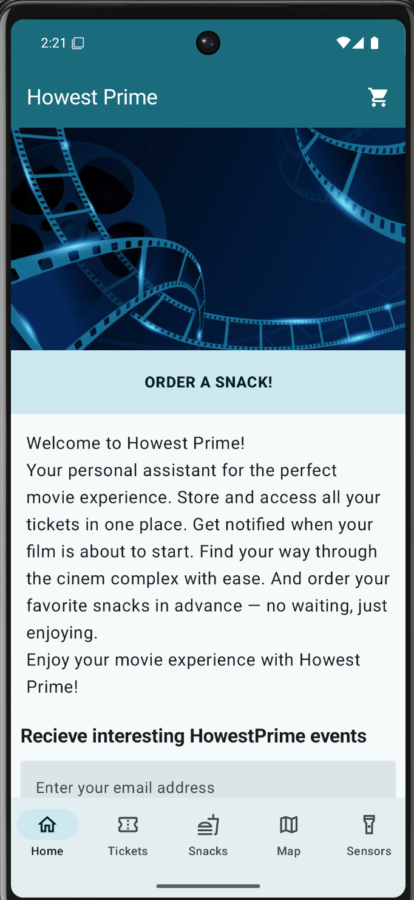
Landing screen, entry point with access to the main app sections.

### Tickets — Upcoming
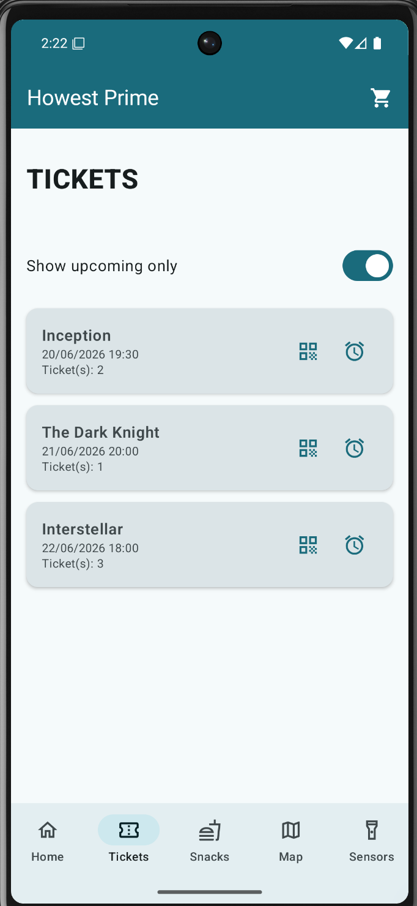
Tickets list filtered to upcoming tickets.

### Tickets — All
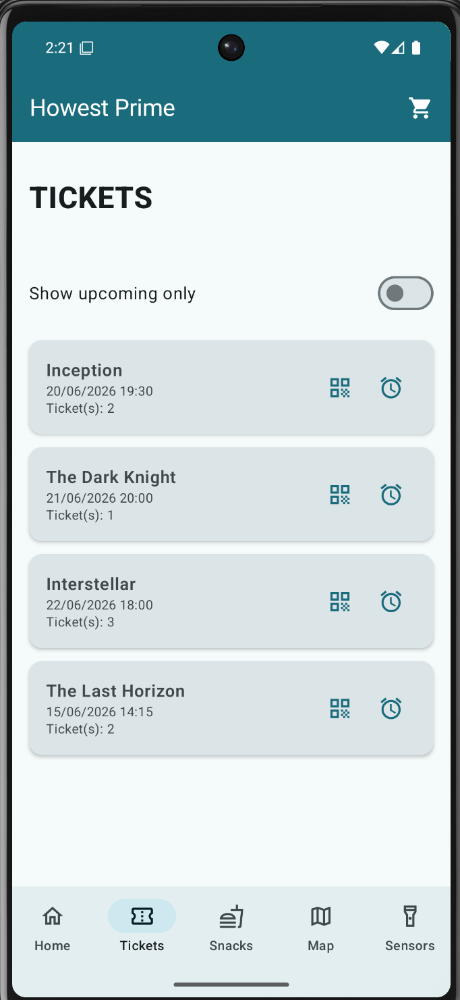
Tickets list showing all tickets.

### Ticket Detail

Detail view of a single selected ticket.

### Snacks
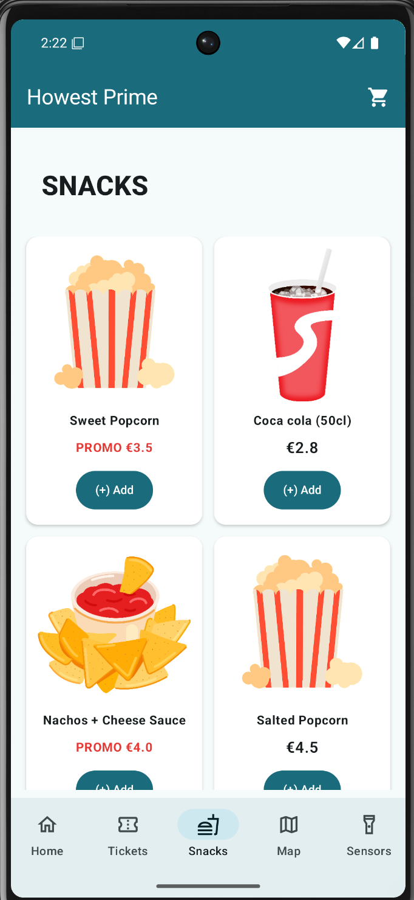
Browse and order snacks.

### Cart
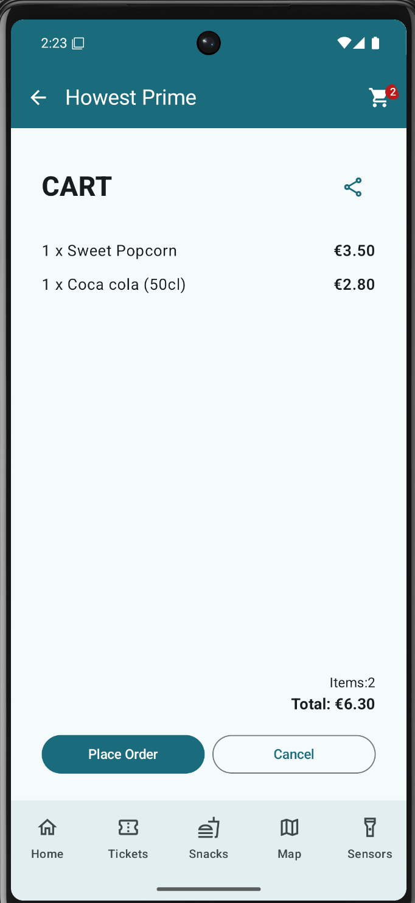
Shopping cart with the selected snack order.

### Cart — Share Intent
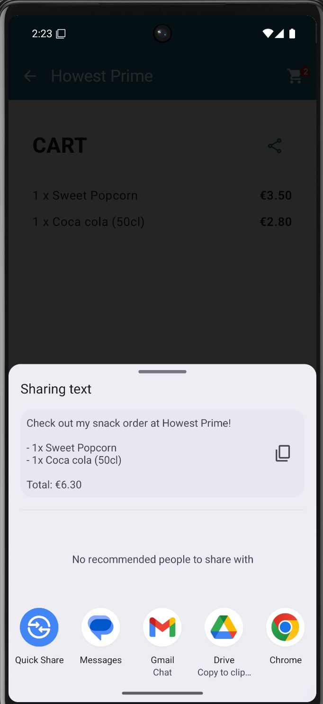
Sharing the cart via an Android share intent.

### Location — Indoor
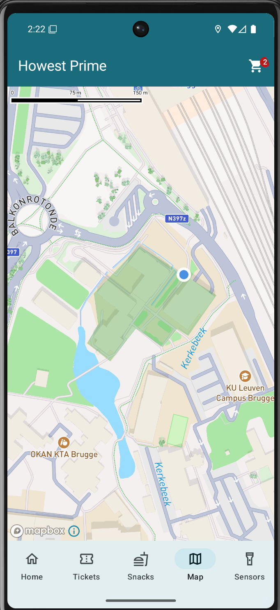
Map (with user in the building).

### Location — Outdoor
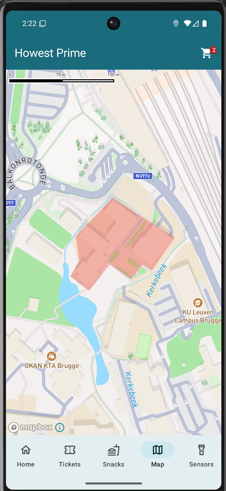
Map (with user outside the building).

### Sensors
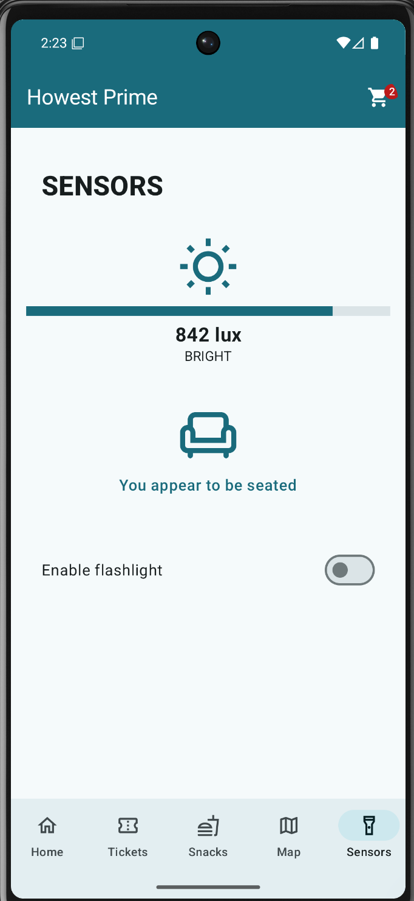
Device sensor controls (flashlight + acceleration sensor + light sensor).

### Notification — Channel
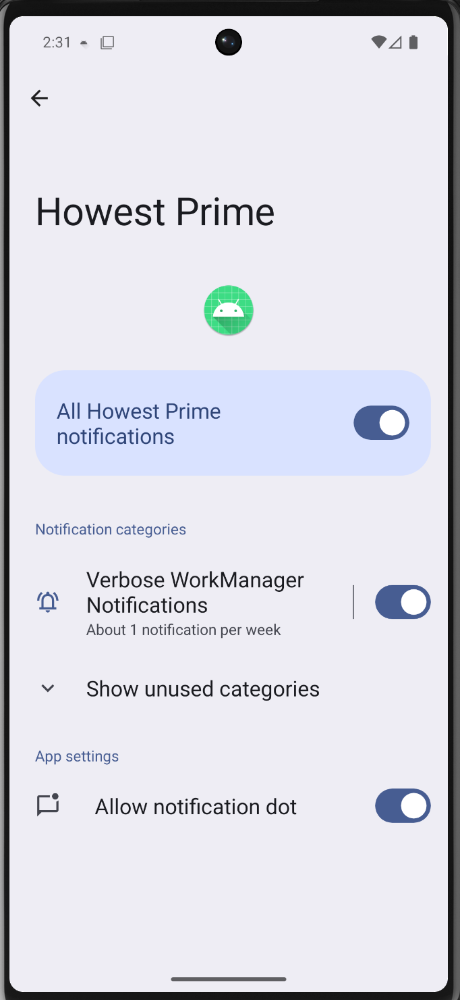
Notification channel settings

### Notification — Top Bar
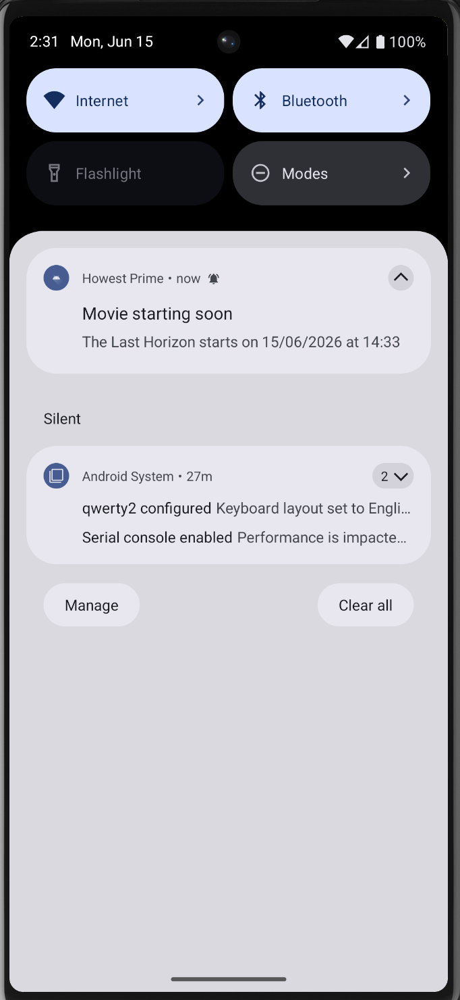
Notification shown in the system top bar.

## Room Database

Describe:
- Stored data [SnackEntity](app/src/main/java/be/howest/howestprime/data/local/room/entity/SnackEntity.kt), [TicketEntity](app/src/main/java/be/howest/howestprime/data/local/room/entity/TicketEntity.kt)

- Related screens [SnackScreen](app/src/main/java/be/howest/howestprime/ui/snacks/SnacksScreen.kt),  [TicketScreen](app/src/main/java/be/howest/howestprime/ui/tickets/TicketsScreen.kt)
- Database structure [SnackEntity](app/src/main/java/be/howest/howestprime/data/local/room/entity/SnackEntity.kt), [TicketEntity](app/src/main/java/be/howest/howestprime/data/local/room/entity/TicketEntity.kt) + [Converters](app/src/main/java/be/howest/howestprime/data/local/room/Converters.kt)

##  API Requests

Describe:
- API endpoint [Screen Endpoints Interface](app/src/main/java/be/howest/howestprime/data/remote/api/SnackApi.kt) + implementation generated by the Retrofit at runtime
- JSON response [Remote request response DTO](app/src/main/java/be/howest/howestprime/data/remote/dto/SnackDto.kt) parsed by moshi
- Screen usage [SnackScreen](app/src/main/java/be/howest/howestprime/ui/snacks/SnacksScreen.kt)

## MessageBroker

Describe:
- Connection setup [Message Consumer adapter](app/src/main/java/be/howest/howestprime/data/messaging/RabbitMQMessageConsumer.kt), [Message Publisher adapter](app/src/main/java/be/howest/howestprime/data/messaging/RabbitMQMessagePublisher.kt)
- Queue/topic usage [Queue (DI) injected when creating an Consumer/Publisher instance](app/src/main/java/be/howest/howestprime/di/MessagingModule.kt)
- Message handling [start listening + handle onMessage + stop listening (if needed) in message Consumer adapter](app/src/main/java/be/howest/howestprime/data/messaging/RabbitMQMessageConsumer.kt), [publish message in message Publisher adapter ](app/src/main/java/be/howest/howestprime/data/messaging/RabbitMQMessagePublisher.kt) => both messaging adapter injected as constructor when creating an instance

## Tickets

Describe:
- Ticket storage: the [message consumer](app/src/main/java/be/howest/howestprime/data/messaging/RabbitMQMessageConsumer.kt) listens for incoming ticket messages, and the [ticket repository](app/src/main/java/be/howest/howestprime/data/repository/TicketRepositoryImpl.kt) handles the resulting callback to persist them.
- Ticket retrieval: the [TicketDao](app/src/main/java/be/howest/howestprime/data/local/room/dao/TicketDao.kt) exposes tickets as a reactive `Flow`
- QR generation => using [external library](https://github.com/alexzhirkevich/qrose)

## Intents

Describe:
- Shared intents: the cart items is shared with other apps through an `ACTION_SEND` chooser intent in [CartScreen](app/src/main/java/be/howest/howestprime/ui/cart/CartScreen.kt).
- Navigation intents: tapping a notification opens a `PendingIntent` that relaunches [MainActivity](app/src/main/java/be/howest/howestprime/MainActivity.kt) implemeted in [WorkerUtils](app/src/main/java/be/howest/howestprime/data/worker/WorkerUtils.kt).
- External app integration: the share chooser lets the user pick any installed app (mail, messaging, …) to forward the order text.

## WorkManager

Describe:
- Background tasks: the [NotficationWorker](app/src/main/java/be/howest/howestprime/data/worker/NotficationWorker.kt) is a `CoroutineWorker` that runs the movie-start reminder off the main thread.
- Scheduling: when a ticket is stored, [TicketRepositoryImpl](app/src/main/java/be/howest/howestprime/data/repository/TicketRepositoryImpl.kt) enqueues a `OneTimeWorkRequest` (provided via [WorkManagerModule](app/src/main/java/be/howest/howestprime/di/WorkManagerModule.kt)). The initial delay is derived from a `minutesBefore` value entered by the user, so the reminder fires that many minutes before the movie starts.
- Notification handling: on execution the worker delegates to [NotificationHelper](app/src/main/java/be/howest/howestprime/data/worker/WorkerUtils.kt) to build and post the reminder notification.

## Notifications

Describe:
- Reminder notifications: [NotificationHelper](app/src/main/java/be/howest/howestprime/data/worker/WorkerUtils.kt) builds a high-priority `NotificationCompat` showing the movie name, date and time.
- Notification channels: a `NotificationChannel` is created on API 26+ before posting, so notifications are grouped under a dedicated channel.
- Trigger moments: the notification is fired by the [NotficationWorker](app/src/main/java/be/howest/howestprime/data/worker/NotficationWorker.kt)

##  Map

Describe:
- Mapbox integration: the map is hosted in [MapScreen](app/src/main/java/be/howest/howestprime/ui/map/MapScreen.kt) and attached/detached via [AttachMapViewUseCase](app/src/main/java/be/howest/howestprime/domain/usecase/AttachMapViewUseCase.kt) / [DetachMapViewUseCase](app/src/main/java/be/howest/howestprime/domain/usecase/DetachMapViewUseCase.kt).
- Geolocation: the user position is streamed through [GetLocationStreamUseCase](app/src/main/java/be/howest/howestprime/domain/usecase/GetLocationStreamUseCase.kt) and rendered as a location marker.
- GeoJSON usage: the cinema outline is loaded as a GeoJSON `Polygon` via [GetCinemaPolygonUseCase](app/src/main/java/be/howest/howestprime/domain/usecase/GetCinemaPolygonUseCase.kt); [CheckInsideBuildingUseCase](app/src/main/java/be/howest/howestprime/domain/usecase/CheckInsideBuildingUseCase.kt) tests whether the user is inside/outside the building.

##  Sensor Data

Describe:
- Sensor usage: [SensorRepositoryImpl](app/src/main/java/be/howest/howestprime/data/repository/SensorRepositoryImpl.kt) registers listeners on the device `SensorManager` and exposes the readings to [SensorsScreen](app/src/main/java/be/howest/howestprime/ui/sensors/SensorsScreen.kt).
- Light detection: a `Sensor.TYPE_LIGHT` listener reports ambient light intensity (lux).
- Movement detection: a `Sensor.TYPE_LINEAR_ACCELERATION` listener reports device movement. The flashlight is toggled through `CameraManager.setTorchMode`.

##  Camera (Optional)

Describe:
- QR scanning implementation: not implemented (QR is only generated, not scanned).
- Camera integration: the camera is currently used only for the flashlight/torch via `CameraManager.setTorchMode` in [SensorRepositoryImpl](app/src/main/java/be/howest/howestprime/data/repository/SensorRepositoryImpl.kt).

# Repositories

## Code Repository
[Link to repository](https://github.com/Howest-TI-Project-BnD/st-client-mobile-sumanadhikari-howest)

##  APK
- [Link to APK]
